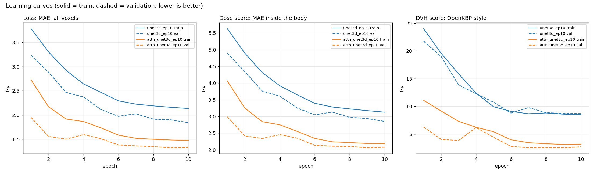

# Monitoring training and comparing models with mlflow

Every run of `test_notebook_rtog_imrt.py` is recorded by mlflow in `KBP_Project/mlruns/`.
This guide shows how to watch a run while it trains and how to compare runs, with and without a web browser.

All commands are run from `KBP_Project` in the `AI_RTP` environment:

```bash
cd /home/grp_airtp/AI_RTP/KBP_Project
conda activate AI_RTP
```

**Quick start (no browser):**

```bash
python mlflow_tools.py list        # all runs
python mlflow_tools.py watch       # follow the newest run until it ends
python mlflow_tools.py compare     # compare all finished runs (table + PNG)
```

---

## 1. What is recorded, and where

The training script (`test_notebook_rtog_imrt.py`) writes to one **experiment**, `RTOG_IMRT_teaching`.
Each execution of the script is one **run**, named by `--run_name` (default `<model>_ep<epochs>`).

| What | Logged in | Content |
|---|---|---|
| **params** (once, at the start of STEP 6) | `train_model()` | `model, epochs, learning_rate, batch_size, seed, loss, select_best_by, optimizer, unet_enc_chs, dropout_p, scheduler, flip_lr_augmentation, n_train, n_val, n_test, n_params_M, peak_gpu_gib, dose_units` |
| **metrics, every epoch** (STEP 6, `step` = epoch) | training loop | `train_loss`, `val_loss` (the MAE loss, Gy), `train_dose_score`, `val_dose_score`, `train_dvh_score`, `val_dvh_score` (the two OpenKBP-style scores, Gy), `lr` |
| **metrics, once at the end of training** (STEP 6) | after the loop | `best_val_loss` (validation MAE at the best epoch), `best_epoch`. If `SELECT_BEST_BY` is not `val_loss`, also `best_val_dose_score` or `best_val_dvh_score`. |
| **metrics, once after testing** (STEP 7) | test loop | `test_<name>_mean`: `test_dose_score_mean`, `test_DVH_score_mean`, `test_MAE_all_mean`, `test_MAE_ptv_mean`, and for the DVH metrics e.g. `test_PTV_D95_absdiff_mean`, `test_Lungs_V20_absdiff_mean` (mean over the test cases; `absdiff` = mean absolute difference predicted - clinical, `diff_signed` = with sign) |
| **artifacts** (STEP 6-8) | `log_artifact` | `best_model.pt`, `learning_curves.png`, `test_metrics.csv`, `test_summary.csv`, `figures/<case_id>/*.png` |

The two scores are defined in `RTOG_IMRT_WORKFLOW.md` ("Evaluation scores"). In short, the **dose score** is the mean absolute error inside the body and the **DVH score** is the mean absolute error of 13 DVH numbers (PTV D1/D95/D99, Dmean and Dmax of five organs). Both are in Gy, lower is better, and both are only **measured**: the network is trained on the MAE loss alone.
The train scores are computed during the training pass (flipped inputs, train mode), the validation scores after it (eval mode), so the two curves are not exactly comparable.
The column `MAE_body` of the earlier version of the script was renamed `dose_score`; its mlflow metric is now `test_dose_score_mean`.

Because the per-epoch metrics are written during training, a run can be watched live.
`best_val_loss` and the `test_*` metrics only exist after the run has finished; for a running run they are empty (NaN).

### Files on disk

```
mlruns/<experiment_id>/<run_id>/
    meta.yaml             run name, status (1=RUNNING, 3=FINISHED, 4=FAILED, 5=KILLED), start_time, end_time (ms since 1970)
    params/<name>         one text file per param, the value only
    metrics/<name>        one text file per metric, one line per logged value
    tags/<name>           e.g. mlflow.runName
    artifacts/            best_model.pt, learning_curves.png, ... (the files listed above)
```

A line in `metrics/<name>` is `<timestamp_ms> <value> <step>`:

```bash
$ cat mlruns/840420768851110961/5fdb2c913cec4c9dad7d5d7fd8f80813/metrics/val_loss
1792430879957 3.2322441389163337 1
1792430915946 2.885191932320595 2
1792430951865 2.4673477758963904 3
...
1792431203569 1.8429115588466327 10
```

`mlruns/840420768851110961` is the experiment `RTOG_IMRT_teaching` (`mlruns/0` is an unused default experiment).
The training script also keeps its own copy of the outputs in `results/rtog_imrt_teaching/<run_name>/` (and the stdout in `results/rtog_imrt_teaching/<run_name>.log` if you redirect it, see 3d).

---

## 2. Option A: the web UI

### Heads-up: `mlflow ui` does not work in the `AI_RTP` environment on this server

Checked on this machine (mlflow 3.3.2 from the Anaconda `main` channel):

* `mlflow ui` crashes at start-up (`TypeError: Router.__init__() got an unexpected keyword argument 'on_startup'`): the installed `starlette` 1.x is too new for the installed `fastapi`.
* With `--gunicorn-opts ""` the server starts, but the page says *"Unable to display MLflow UI - landing page (index.html) not found"*: this conda build of mlflow ships without the web front-end.

The tracking itself (training, `mlflow_tools.py`, the Python API) is not affected.
To use the UI, install mlflow from pip into a **separate virtual environment** (about 800 MB; tested):

```bash
# once
/home/grp_airtp/anaconda3/envs/AI_RTP/bin/python -m venv ~/mlflow_ui_env
~/mlflow_ui_env/bin/pip install mlflow==3.3.2
```

Then, whenever you want the UI (the `AI_RTP` environment is not needed for this):

```bash
cd /home/grp_airtp/AI_RTP/KBP_Project
~/mlflow_ui_env/bin/mlflow ui --backend-store-uri file:mlruns --host 127.0.0.1 --port 5000
```

Leave it running in that terminal (Ctrl-C stops it). It reads the same `mlruns` folder the training writes to, so you can start the UI before, during or after training.
(If your instructor has fixed the shared environment, `mlflow ui --backend-store-uri file:mlruns ...` in `AI_RTP` works as well.)

**Do not use `--host 0.0.0.0` on this shared server.** It makes the UI listen on every network interface, and the mlflow UI has no login: anybody who can reach the machine could read, rename and delete everybody's runs.
`127.0.0.1` accepts local connections only, and the SSH tunnel below brings it to your laptop safely.

### Reach it from your laptop (SSH port forwarding)

```bash
# on your laptop (macOS / Linux terminal, Windows PowerShell or cmd with OpenSSH):
ssh -L 5000:localhost:5000 <user>@<server>
```

Keep this SSH session open, start `mlflow ui` in it (or in a second SSH session), then open **http://localhost:5000** in the browser on your laptop.

* **VS Code Remote-SSH:** ports are forwarded automatically when the terminal prints `http://127.0.0.1:5000`; otherwise open the *Ports* tab, click *Forward a Port*, enter `5000`.
* **MobaXterm:** *Tunneling* -> *New SSH tunnel* -> *Local port forwarding*: forwarded port 5000, remote server `localhost`, remote port 5000, SSH server = the workstation; start the tunnel, then open http://localhost:5000.
* **PuTTY:** *Connection -> SSH -> Tunnels*: source port 5000, destination `localhost:5000`, *Local*, *Add*, then open the session.

**Port already in use** (`Connection in use` / `Address already in use`, someone else on the server may use 5000): pick another port, on both sides of the tunnel:

```bash
~/mlflow_ui_env/bin/mlflow ui --backend-store-uri file:mlruns --host 127.0.0.1 --port 5017
ssh -L 5017:localhost:5017 <user>@<server>        # then open http://localhost:5017
```

### What to click

* **Watch a running run:** open the experiment `RTOG_IMRT_teaching` -> click the run name -> tab **Model metrics**. The charts of `train_loss`, `val_loss`, `val_dose_score`, `val_dvh_score` and `lr` refresh automatically while the run is RUNNING (or press the refresh button).
* **Compare runs:** in the runs table tick the checkboxes of two or more runs -> **Compare**. Then:
  * *Parallel coordinates plot*, *Scatter plot*, *Box plot* tabs: choose params (e.g. `model`) and metrics (`test_dose_score_mean`, `test_DVH_score_mean`, `test_MAE_ptv_mean`).
  * *Run details*: side-by-side table of all params and metrics.
  * On the experiment page, switch to the **Chart view** (chart icon next to the table icon) to overlay `train_loss`, `val_loss` and the two scores of the selected runs.
* **Artifacts:** run page -> tab **Artifacts**. Click `learning_curves.png` or `figures/<case_id>/...png` to view them; click `test_metrics.csv` to see it as a table; there is a download button for each file.
* In the runs table, use *Columns* to show the metrics you care about and click a column header to sort.

(Not tested in a browser here: the UI was only checked to start and to answer its API and artifact requests. Menu labels may differ slightly between mlflow versions.)

---

## 3. Option B: without the web UI

### 3a. `mlflow_tools.py`

A small script (`KBP_Project/mlflow_tools.py`, read it, it is short) that works in any terminal.
Run `python mlflow_tools.py --help` or `python mlflow_tools.py <command> --help` for all options.
Run names or run ids can be used wherever a run is needed.

#### `list` - all runs

```bash
python mlflow_tools.py list
python mlflow_tools.py list --sort best_val_loss      # best first; unfinished runs (empty) last
```

```
experiment RTOG_IMRT_teaching | store file:/home/grp_airtp/AI_RTP/KBP_Project/mlruns | losses in Gy
        run_name   status       start duration       model epochs  done train_loss val_loss val_dvh_score best_val_loss best_epoch test_dose_score test_DVH_score test_MAE_ptv
     unet3d_ep10 FINISHED 10-19 13:27  0:06:10      unet3d     10    10      2.135    1.843         8.674         1.843         10           2.748          8.205       12.085
attn_unet3d_ep10 FINISHED 10-19 13:34  0:05:44 attn_unet3d     10    10      1.475    1.331         2.684         1.324          9           2.023          2.800        2.418
```

`done` = epochs finished so far; `train_loss`, `val_loss` and `val_dvh_score` = the latest epoch. `best_val_loss` is the validation MAE of the best epoch, so it can be lower than the latest `val_loss` (attention U-Net: 1.324 at epoch 9, 1.331 at epoch 10). The `test_*` columns are filled when the run has finished. A run in progress shows status `RUNNING`, `done` below `epochs`, and empty `best_val_loss`, `best_epoch` and `test_*` columns.

**Killed runs.** mlflow only sets FINISHED/FAILED when the Python process ends by itself or with an exception. If a job is killed (`kill -9`, closed SSH session without `nohup`, GPU out-of-memory crash of the whole process, server reboot), its status stays **RUNNING forever** and `duration` keeps growing. `mlflow_tools.py` shows such a run as `RUNNING?` when nothing was logged for 30 minutes (change with `--stale_minutes`). Check with `pgrep -af test_notebook_rtog_imrt` whether it is really still alive. If not, close it so that it stops looking active:

```bash
python - <<'EOF'
import mlflow
from mlflow.tracking import MlflowClient
mlflow.set_tracking_uri("file:mlruns")
MlflowClient().set_terminated("<run_id>", status="KILLED")      # run id from "list"/the log; or use "FAILED"
EOF
```

(`list` shows run names; get the run id with `mlflow runs list --experiment-id 840420768851110961`, see 3c.)

#### `watch` - follow a run live

```bash
python mlflow_tools.py watch                      # newest run, check every 30 s, stop when it is no longer RUNNING
python mlflow_tools.py watch attn_unet3d_ep10 --interval 10
python mlflow_tools.py watch attn_unet3d_ep10 --once     # print what exists now and exit
```

Real output of `python mlflow_tools.py watch unet3d_ep10 --once` (the run is finished, so everything is printed at once; for a running run the table grows as epochs are logged):

```
watching run unet3d_ep10 (5fdb2c91), 10 epochs planned. Ctrl-C stops watching (training keeps running).
 epoch   train_loss     val_loss val_dose_score  val_dvh_score         lr
     1       3.7829       3.2322         4.8904        21.7579    5.0e-04
     2       3.3031       2.8852         4.3429        18.9970    5.0e-04
     3       2.9228       2.4673         3.7597        13.8673    5.0e-04
     4       2.6429       2.3720         3.6094        12.2577    5.0e-04
     5       2.4671       2.1117         3.2515        10.7459    5.0e-04
     6       2.2929       1.9737         3.0484         8.7687    5.0e-05
     7       2.2246       2.0253         3.1326         9.7727    5.0e-05
     8       2.1885       1.9148         2.9724         8.8469    5.0e-05
     9       2.1593       1.9001         2.9387         8.7114    5.0e-05
    10       2.1349       1.8429         2.8513         8.6741    5.0e-05
run is FINISHED after 10 epochs.
best_val_loss 1.8429 Gy at epoch 10
test_dose_score_mean 2.7482 Gy
test_DVH_score_mean 8.2054 Gy
test_MAE_all_mean 1.9534 Gy
```

Ctrl-C only stops the watcher, never the training. If a run is RUNNING but silent for more than `--stale_minutes`, `watch` prints a warning (probably killed, see above) and keeps waiting.

#### `compare` - side by side

```bash
python mlflow_tools.py compare                                  # all FINISHED runs
python mlflow_tools.py compare unet3d_ep10 attn_unet3d_ep10     # chosen runs
python mlflow_tools.py compare --csv results/rtog_imrt_teaching/compare_runs.csv --out my_curves.png
```

```
                                 unet3d_ep10 attn_unet3d_ep10
status                              FINISHED         FINISHED
duration                             0:06:10          0:05:44
param model                           unet3d      attn_unet3d
param peak_gpu_gib                      11.3             11.0
param n_params_M                       25.89            24.84
test_dose_score_mean                   2.748            2.023
test_DVH_score_mean                    8.205            2.800
best_val_loss                          1.843            1.324
best_epoch                                10                9
test_MAE_all_mean                      1.953            1.519
test_MAE_ptv_mean                     12.085            2.418
test_PTV_D95_absdiff_mean             10.986            2.785
test_PTV_D2_absdiff_mean              12.728            1.922
test_PTV_Mean_absdiff_mean            11.693            1.851
test_Lungs_V20_absdiff_mean            4.832            4.830
test_Lungs_V5_absdiff_mean             4.899            4.342
test_Lungs_Mean_absdiff_mean           2.740            1.425
test_Heart_V30_absdiff_mean            7.504            5.383
test_Heart_V5_absdiff_mean             6.630            4.109
test_Heart_Mean_absdiff_mean           3.274            1.849
test_Esophagus_Mean_absdiff_mean       5.549            2.301
test_Spinalcord_Max_absdiff_mean       7.680            4.973
```

Only the params that differ between the runs are listed (their row order can change from call to call). The two scores come first because they are the headline numbers. An unfinished run has empty cells for the metrics it has not logged yet. The PNG (default `results/rtog_imrt_teaching/compare_runs.png`) has three panels, loss | dose score | DVH score; solid = train, dashed = validation, one colour per run. It is drawn from the full metric history of every run:



Copy it to your laptop with `scp <user>@<server>:/home/grp_airtp/AI_RTP/KBP_Project/results/rtog_imrt_teaching/compare_runs.png .`

#### `artifacts` - files of a run and where they are

```bash
python mlflow_tools.py artifacts unet3d_ep10
python mlflow_tools.py artifacts unet3d_ep10 --grep .png      # only the images
```

```
run unet3d_ep10 (5fdb2c91) - artifact folder: /home/grp_airtp/AI_RTP/KBP_Project/mlruns/840420768851110961/5fdb2c913cec4c9dad7d5d7fd8f80813/artifacts
    103.6 MB  /home/grp_airtp/AI_RTP/KBP_Project/mlruns/840420768851110961/5fdb2c913cec4c9dad7d5d7fd8f80813/artifacts/best_model.pt
      0.5 MB  /home/grp_airtp/AI_RTP/KBP_Project/mlruns/840420768851110961/5fdb2c913cec4c9dad7d5d7fd8f80813/artifacts/figures/0617-410508_0/0617-410508_0_dose_comparison.png
      ...
      0.2 MB  /home/grp_airtp/AI_RTP/KBP_Project/mlruns/840420768851110961/5fdb2c913cec4c9dad7d5d7fd8f80813/artifacts/learning_curves.png
      0.0 MB  /home/grp_airtp/AI_RTP/KBP_Project/mlruns/840420768851110961/5fdb2c913cec4c9dad7d5d7fd8f80813/artifacts/test_metrics.csv
      0.0 MB  /home/grp_airtp/AI_RTP/KBP_Project/mlruns/840420768851110961/5fdb2c913cec4c9dad7d5d7fd8f80813/artifacts/test_summary.csv
16 files, 108.0 MB
open a PNG with any viewer, or copy to your laptop: scp "<user>@<server>:/home/grp_airtp/AI_RTP/KBP_Project/mlruns/840420768851110961/5fdb2c913cec4c9dad7d5d7fd8f80813/artifacts/learning_curves.png" .
```

(Lines marked `...` are omitted here; the full listing has the 12 figures of the 3 test cases.) With `--grep .png` only the 13 images are listed (4.4 MB).

The paths are normal files: open them with any image viewer, or copy them to your laptop (run this on your laptop):

```bash
scp <user>@<server>:/home/grp_airtp/AI_RTP/KBP_Project/mlruns/840420768851110961/5fdb2c913cec4c9dad7d5d7fd8f80813/artifacts/learning_curves.png .
```

The same figures are also in `results/rtog_imrt_teaching/<run_name>/figures/`.

### 3b. Python API (notebook or script)

```python
import mlflow
import matplotlib.pyplot as plt
from mlflow.tracking import MlflowClient

mlflow.set_tracking_uri("file:/home/grp_airtp/AI_RTP/KBP_Project/mlruns")   # absolute path: works from any folder

# one row per run: params.*, metrics.* (LAST value of each metric), status, start_time, tags.*
runs = mlflow.search_runs(experiment_names=["RTOG_IMRT_teaching"])
cols = ["tags.mlflow.runName", "status", "params.model", "metrics.best_val_loss",
        "metrics.test_dose_score_mean", "metrics.test_DVH_score_mean"]
print(runs[cols].sort_values("metrics.test_DVH_score_mean").to_string(index=False))
```

```
tags.mlflow.runName   status params.model  metrics.best_val_loss  metrics.test_dose_score_mean  metrics.test_DVH_score_mean
   attn_unet3d_ep10 FINISHED  attn_unet3d               1.323617                      2.022748                     2.799894
        unet3d_ep10 FINISHED       unet3d               1.842912                      2.748243                     8.205359
```

`search_runs` only gives the last value of a metric. For a curve, ask for the history. This plots the validation loss and the validation DVH score of every run:

```python
client = MlflowClient()
fig, axes = plt.subplots(1, 2, figsize=(11, 4))
for _, r in runs.iterrows():
    for ax, metric in zip(axes, ["val_loss", "val_dvh_score"]):
        h = client.get_metric_history(r["run_id"], metric)          # list of (step, value, timestamp)
        ax.plot([m.step for m in h], [m.value for m in h], label=r["tags.mlflow.runName"])
        ax.set_title(metric); ax.set_xlabel("epoch"); ax.set_ylabel("Gy"); ax.legend()
plt.tight_layout(); plt.show()
```

(Both snippets were run as written, with `plt.savefig(...)` in place of `plt.show()`; the table is their real output.)

Filters work like SQL, e.g. `mlflow.search_runs(experiment_names=["RTOG_IMRT_teaching"], filter_string="params.model = 'unet3d' and status = 'FINISHED'")`.

### 3c. mlflow command line (mlflow 3.3.2)

The command line uses `./mlruns` of the current folder by default, so run it from `KBP_Project` (or `export MLFLOW_TRACKING_URI=file:/home/grp_airtp/AI_RTP/KBP_Project/mlruns` to run it from anywhere).

```bash
mlflow experiments search                                    # experiment ids (RTOG_IMRT_teaching = 840420768851110961)
mlflow runs list --experiment-id 840420768851110961          # date, name, run id (no status/metrics in this table)
mlflow runs describe --run-id 5fdb2c913cec4c9dad7d5d7fd8f80813     # JSON: status, all params and metrics (last values)
mlflow artifacts list --run-id 5fdb2c913cec4c9dad7d5d7fd8f80813    # JSON list of the artifact files
mlflow artifacts download --run-id 5fdb2c913cec4c9dad7d5d7fd8f80813 --artifact-path learning_curves.png --dst-path ./downloaded
mlflow experiments csv --experiment-id 840420768851110961 --filename runs.csv    # all runs as one CSV
```

Not available in 3.3.2: there is no `mlflow runs rename` and no `mlflow runs search`; there is no CLI to print a metric history (use `cat metrics/<name>`, see 3d, or the Python API).
`mlflow artifacts download` copies the file (for a local store, it is a copy of the file in `mlruns/.../artifacts`); for `best_model.pt` this means another 100 MB.

### 3d. Plain shell

```bash
# GPU usage, refreshed every second
watch -n 1 nvidia-smi

# follow the log of a training run (see below for how it is written); --line-buffered makes grep print at once
tail -f results/rtog_imrt_teaching/attn_unet3d_ep10.log | grep --line-buffered Epoch

# raw metric file of a run: <timestamp_ms> <value> <step>
cat mlruns/840420768851110961/<run_id>/metrics/val_loss
cat mlruns/840420768851110961/<run_id>/params/learning_rate

# copy results to your laptop (run on your laptop)
scp -r <user>@<server>:/home/grp_airtp/AI_RTP/KBP_Project/results/rtog_imrt_teaching/attn_unet3d_ep10/figures .
```

#### Start training in the background so it survives a closed SSH session

```bash
cd /home/grp_airtp/AI_RTP/KBP_Project
nohup python -u test_notebook_rtog_imrt.py --model attn_unet3d --epochs 10 --run_name attn_unet3d_ep10 \
    > results/rtog_imrt_teaching/attn_unet3d_ep10.log 2>&1 &
echo $!                              # process id
```

* **Use `python -u`.** Without it, Python collects the output in an 8 KB buffer when it writes to a file, so `tail -f` shows the `Epoch` lines late or only at the end (checked here). mlflow itself is not affected: `mlflow_tools.py watch` always shows the epochs at once.
* `results/rtog_imrt_teaching/` must exist (it does after the first run).
* Check that it is alive: `pgrep -af test_notebook_rtog_imrt`. Stop it (on purpose) with `kill <pid>`; the run then stays RUNNING in mlflow, see "Killed runs" above.
* `tmux` or `screen` are alternatives; you can then reattach and see the live output.
* Two runs at the same time need two free GPUs or about 12 GB of GPU memory each (`peak_gpu_gib`); check `nvidia-smi` first, the machine is shared.

---

## 4. Worked example: `unet3d_ep10` vs `attn_unet3d_ep10`

Both runs: 10 epochs, learning rate 5e-4 dropping to 5e-5 after epoch 5, same seed and same split (115 train / 24 validation / 24 test cases), only the network differs. The checkpoint was chosen by `val_loss` (`SELECT_BEST_BY` default). Numbers come from `history.csv`, `test_summary.csv` and `compare_runs.csv` in `results/rtog_imrt_teaching/`. All values are in Gy in normalised units (PTV mean = 60 Gy), except V20 (% volume).

| | unet3d_ep10 | attn_unet3d_ep10 |
|---|---|---|
| parameters (M) | 25.89 | 24.84 |
| training time | 6.0 min (36 s / epoch) | 5.6 min (33.5 s / epoch) |
| **test dose score** (MAE inside the body) | **2.748** | **2.023** |
| **test DVH score** (13 DVH metrics) | **8.205** | **2.800** |
| last epoch (10): train / val MAE | 2.135 / 1.843 | 1.475 / 1.331 |
| last epoch (10): val dose score / val DVH score | 2.851 / 8.674 | 2.079 / 2.684 |
| best epoch by `val_loss` (val MAE there) | 10 (1.843) | 9 (1.324) |
| test MAE all voxels (the loss) | 1.953 | 1.519 |
| test MAE inside PTV | 12.085 | 2.418 |
| PTV D95 abs. error | 10.986 | 2.785 |
| Lungs V20 abs. error (% vol.) | 4.832 | 4.830 |
| Heart mean dose abs. error | 3.274 | 1.849 |


The figure has three panels (loss | dose score | DVH score), solid = train, dashed = validation, blue = U-Net, orange = attention U-Net. The per-run file `<run_name>/learning_curves.png` has the same three panels for one run, with the best epoch marked.

**How to read the panels**

* **Loss panel (the MAE that is optimised).** The U-Net validation loss is still falling at epoch 10 (its best epoch is the last one), so it has not converged. The attention U-Net flattens after the learning-rate drop (1.382, 1.362, 1.347, 1.324, 1.331 for epochs 6 to 10) and its training loss is still going down slowly. 10 epochs is short for both. This is the picture of **under-fitting / not trained long enough**. Over-fitting would look different: training loss keeps falling while the validation loss flattens or rises, and the gap grows. The attention U-Net's epoch 10 being slightly worse than epoch 9 is noise of this size, not over-fitting. In longer runs (100 epochs) watch for the pattern; that is what `best_epoch` and the saved best checkpoint are for.
* **Dose-score panel.** Same shape as the loss panel, shifted up, because it averages over the body only: the air around the patient is easy to predict (0 Gy) and dilutes the MAE in the loss panel. A model that is good here is good on average over the patient. The gap between the models (2.748 vs 2.023 on the test set) is of similar relative size as in the loss panel (1.953 vs 1.519).
* **DVH-score panel.** This is the panel that separates the models: the attention U-Net is at 2.8 Gy, the U-Net at 8.2 Gy on the test set (ratio 0.34, compared with 0.74 for the dose score and 0.78 for the MAE). The DVH score uses the hottest voxels (D1, Dmax) and the dose inside the PTV, which the loss barely weights, so it exposes the PTV under-dosing of the U-Net that the average hides. The curve is also **more volatile**: the attention U-Net validation DVH score jumps from 3.823 (epoch 3) to 6.164 (epoch 4) and back to 4.423 (epoch 5), while its validation MAE moves only from 1.503 to 1.596 (+6%) and 1.510 (the DVH score rose by 61%). A quantile or a maximum of a few voxels reacts strongly to a small shift in the PTV level or to one hot voxel. BatchNorm with batch size 1 is a likely cause of the epoch-4 jump (not tested). Do not pick a checkpoint by one epoch's DVH score without looking at the curve.
* **The kink at epoch 6** in all curves is the learning-rate drop: `StepLR(step=epochs//2, gamma=0.1)` divides the rate by 10 after epoch 5 (the `lr` metric changes from 5.0e-04 to 5.0e-05 at step 6). After the drop the curves flatten and become smoother because the optimizer takes smaller steps. This is why a short run gets "easier" numbers at the end than a long run at the same epoch.
* **Why is val lower than train in the loss and dose-score panels?** Several effects, all expected:
  1. The training value is averaged over the epoch while the weights are still improving; the validation value is computed afterwards with the final weights of that epoch.
  2. The training cases are randomly flipped left-right (`flip_lr_augmentation`); validation cases are not. The train scores are computed on these flipped, train-mode predictions.
  3. The training phase runs in train mode: `unet3d` has dropout (`Dropout3d`, p=0.4) in its encoder, which is off in validation; both networks use normalisation layers that behave differently in train and eval mode (the attention U-Net uses batch normalisation with batch size 1).
  4. The validation set is only 24 cases and may be a little easier than the training set. With more epochs the two curves usually cross.
  In the DVH-score panel the U-Net's train and validation curves lie close together and cross several times (train is above validation in 5 of 10 epochs); the attention U-Net's validation curve stays below its training curve in all 10 epochs.
* **Averages hide the PTV.** Over the whole volume the two models differ by 0.43 Gy (1.953 vs 1.519), because most voxels are low-dose background. The dose score differs by 0.73 Gy. Inside the PTV, where the dose is about 60 Gy, the plain U-Net is off by 12.1 Gy (mean signed PTV-mean error -5.98 Gy: it under-doses the target on average, with a standard deviation of 12.3 Gy over the cases) while the attention U-Net is off by 2.4 Gy. That is why `compare` shows the scores and the DVH metrics next to the loss. Which DVH metrics drive the score: in `test_summary.csv` the largest errors are PTV D95 and D2 (U-Net 10.986 and 12.728) and the cord maximum (7.680), compared with 2.7 to 5.5 for the organ means. (The PTV D1, D99 and the other organ maxima that enter the DVH score are not stored in `test_metrics.csv`.)
* **Per case.** On the 24 test cases the attention U-Net has the lower dose score in 21, the lower DVH score in 23 and the lower MAE (all voxels) in 19. The U-Net under-doses the PTV mean by more than 10 Gy in 11 cases. The attention U-Net's PTV-mean error lies between -5.1 and +2.0 Gy in all 24 cases.
* **Not every metric favours the attention U-Net.** The mean absolute error of lung V20 is the same for the two models (4.832 vs 4.830 % volume), and the lung and heart V5 errors differ by less than their standard deviations.

**Honest conclusion.** After 10 epochs the attention U-Net had learned the high-dose region much better than the plain U-Net, and the DVH score shows it far more clearly than the dose score or the loss. This does **not** show that attention U-Nets are better in general: these are one 10-epoch run per model, evaluated on 24 test cases, neither model has converged, and the difference may partly come from random initialisation and from the plain U-Net simply being slower to start. (Re-running the same command also gives slightly different numbers, because the cuDNN kernels are not deterministic.) To make a claim you need converged models (e.g. 100 epochs), several seeds (`SEED` in the CONFIG), and the spread of the per-case errors (`test_metrics.csv`), not just the means.

---

## 5. Housekeeping

**Delete a bad run.** Deleting only moves a run to a trash state; `mlflow gc` removes the files. `mlflow gc` needs `MLFLOW_TRACKING_URI` as well as `--backend-store-uri` (it fails with "Tracking URL is not set" otherwise; verified on this machine):

```bash
cd /home/grp_airtp/AI_RTP/KBP_Project
mlflow runs delete --run-id <run_id>                                   # run disappears from list / the UI
MLFLOW_TRACKING_URI=file:mlruns mlflow gc --backend-store-uri file:mlruns    # permanently deletes ALL runs in the trash
mlflow runs restore --run-id <run_id>                                  # before gc only: undo
```

`gc` is permanent. It does not touch `results/rtog_imrt_teaching/<run_name>/`; delete that folder yourself if you want the files gone too.

**Rename a run** (there is no CLI for it; the run name is the tag `mlflow.runName`; the `results/` folder keeps its old name):

```python
import mlflow
from mlflow.tracking import MlflowClient
mlflow.set_tracking_uri("file:/home/grp_airtp/AI_RTP/KBP_Project/mlruns")
MlflowClient().set_tag("<run_id>", "mlflow.runName", "unet3d_ep10_lr5e-4")
```

**Tag a run** (free text such as `note`, `status`, `student`; tags are shown in `mlflow runs describe` and in the UI, and can be used in filters, e.g. `filter_string="tags.keep = 'yes'"`):

```python
MlflowClient().set_tag("<run_id>", "note", "first baseline, flip augmentation on")
```

Inside the training script, while a run is active, the same can be written `mlflow.set_tag("note", "...")`.

**Disk space.** `best_model.pt` (about 100 MB) is logged for every run, so `mlruns/` grows by about 100 MB per run (203 MB for the two runs above, see `du -sh mlruns`). The checkpoint also exists in `results/rtog_imrt_teaching/<run_name>/best_model.pt`, so it is stored twice. Delete runs you do not need (above), and keep `mlruns/` out of git.
